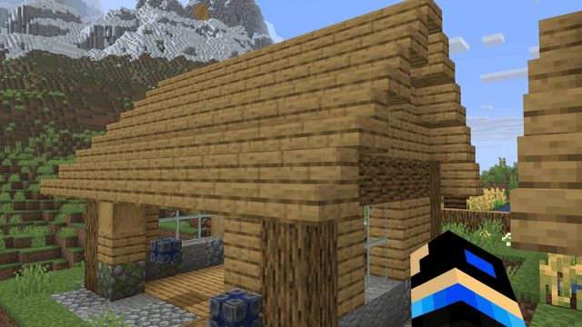

# Warp Anchors

**Quick short range teleportation between Warp Anchors!**

**Warp Anchors** allows you to quickly teleport over short distances. While standing on a Warp Anchor, you can see all
other anchors within 100 blocks, even through walls. Look at the anchor you want to go to and left-click to warp there.
Anchors can be given a name and a color to create separate networks.

### Features
- Warp between anchors up to 100 blocks apart, in any direction (the range can be changed in the config)
- Anchors you can warp to show through walls, with the name of the one you look at
- 16 colors for separate networks: colored anchors warp to their own color and to colorless anchors

For the full description and the recipe, see the  [Modrinth](https://modrinth.com/mod/warp-anchors)
or  [CurseForge](https://www.curseforge.com/minecraft/mc-mods/warp-anchors) page.

### Issues and Suggestions
Found a bug or have a suggestion? Please open an [issue](https://github.com/SuperMartijn642/WarpAnchors/issues).

For questions and discussion, feel free to join the SuperMartijn642 discord server!

